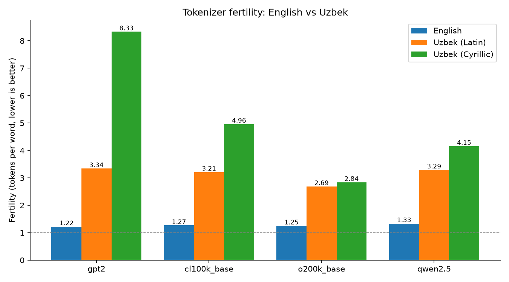

# Uzbek Tokenizer Analysis

> **Why is using LLMs in Uzbek more expensive — and how much can a custom tokenizer fix it?**

🚧 **Status:** work in progress — see [PLAN.md](PLAN.md) for the roadmap.

## Motivation

LLM APIs charge per token, and a model's context window is measured in tokens.
Most popular tokenizers (GPT-2, GPT-4, Llama, Qwen) were trained mostly on English text,
so Uzbek words are split into many more pieces. That means Uzbek users:

- pay **more** for the same message,
- fit **less** text into the context window,
- and get models that "see" Uzbek words as fragments instead of meaningful units.

This project measures that gap and builds a small Uzbek BPE tokenizer to see how much it can be closed.
Uzbek is written in both **Latin** and **Cyrillic** scripts, so both are compared.

## What this project does

| Part | Description | Status |
|---|---|---|
| 1. Data | Uzbek Wikipedia subset + parallel test set (uz-Latin / uz-Cyrillic / English) | ✅ |
| 2. Benchmark | Compare existing tokenizers (`gpt2`, `cl100k_base`, `o200k_base`, Qwen, Llama) | ✅ |
| 3a. BPE from scratch | Minimal byte-pair encoding implementation in pure Python | 🟡 |
| 3b. Custom tokenizer | Train Uzbek BPE tokenizers (8k / 16k / 32k vocab) with HF `tokenizers` | ⬜ |
| 4. Pipeline | Sliding-window dataset → token embeddings → positional embeddings (PyTorch) | ⬜ |

## Metric

**Fertility** = number of tokens / number of words. Lower is better (1.0 = one token per word).

## Results

Fertility on the 20-sentence parallel test set ([data/test_sentences.json](data/test_sentences.json)).
Reproduce with `python src/compare_tokenizers.py`.



*Fertility (tokens per word) for each tokenizer. The dashed line at 1.0 is the ideal: one token per word.
English stays close to it (~1.2–1.3), while Uzbek needs 2–3× more tokens in Latin script
and up to 6.8× more in Cyrillic (GPT-2). `o200k_base` handles Uzbek best, but the gap is still over 2×.*

| Tokenizer | English | Uzbek (Latin) | Uzbek (Cyrillic) | uz-Latin / en | uz-Cyrillic / en |
|---|---|---|---|---|---|
| gpt2 | 1.22 | 3.34 | 8.33 | 2.73× | 6.82× |
| cl100k_base | 1.27 | 3.21 | 4.96 | 2.53× | 3.92× |
| o200k_base | 1.25 | 2.69 | 2.84 | 2.15× | 2.27× |
| qwen2.5 | 1.33 | 3.29 | 4.15 | 2.47× | 3.11× |
| uz-bpe-16k (ours) | – | – | – | – | – |

### BPE from scratch (Part 3a)

A minimal byte-level BPE in pure Python ([src/bpe_from_scratch.py](src/bpe_from_scratch.py)),
trained on 200k characters of Uzbek Wikipedia (Latin script). Reproduce with `python src/bpe_from_scratch.py`.

| Tokenizer | Vocab | English | Uzbek (Latin) | Uzbek (Cyrillic) |
|---|---|---|---|---|
| gpt2 | 50,257 | 1.22 | 3.34 | 8.33 |
| BPE, 50 merges | 306 | 5.02 | 5.47 | 13.51 |
| BPE, 500 merges | 756 | 3.92 | 3.73 | 12.60 |

- **BPE rediscovers Uzbek grammar.** Among the first merges are suffixes: `lar` (plural), `da ` / `ga ` / `dan `
  (case endings), `ing` (genitive), plus the letters `oʻ`, `gʻ`. Uzbek is agglutinative (stem + suffixes),
  and pure frequency counting is enough to find that structure.
- **The training data decides, not the language.** Trained on Uzbek, our BPE is better on Uzbek than on
  English (3.73 vs 3.92) — the opposite of GPT-2.
- **A 66× smaller vocab is already close to GPT-2** on Uzbek Latin (3.73 vs 3.34 with 756 vs 50,257 tokens).
- **Script and apostrophe mismatches hurt.** Cyrillic stays poor (12.60) because the training text is Latin.
  Wikipedia writes `oʻ` with `ʻ` (U+02BB) while the test set uses `'` (U+0027), so learned merges do not fire —
  apostrophe normalization is planned for Part 3b.

Full notes: [steps/STEP-04-bpe-from-scratch.md](steps/STEP-04-bpe-from-scratch.md).

## Key findings

_Coming soon._

## Project structure

```
uzbek-tokenizer-analysis/
├── data/
│   └── test_sentences.json     # parallel test set: uz-Latin, uz-Cyrillic, English
├── src/
│   ├── compare_tokenizers.py   # Part 2: benchmark existing tokenizers
│   ├── bpe_from_scratch.py     # Part 3a: minimal BPE implementation
│   ├── train_hf_tokenizer.py   # Part 3b: train Uzbek tokenizers
│   └── pipeline.py             # Part 4: dataloader + embeddings
├── results/                    # tables and charts
├── notes/                      # study notes
├── PLAN.md                     # roadmap and checklist
└── requirements.txt
```

## How to run

```bash
python -m venv .venv
source .venv/bin/activate
pip install -r requirements.txt

python src/compare_tokenizers.py
```

## Background

Built while studying Chapter 2 ("Working with text data") of
*Build a Large Language Model (From Scratch)* by Sebastian Raschka.

## Author

**Dilshod Bakhtiyorov** — Backend Engineer moving into Generative AI · Tashkent, Uzbekistan
